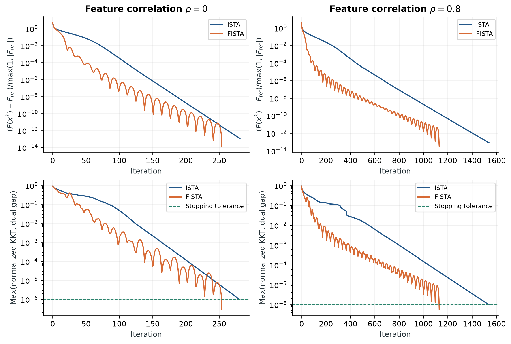
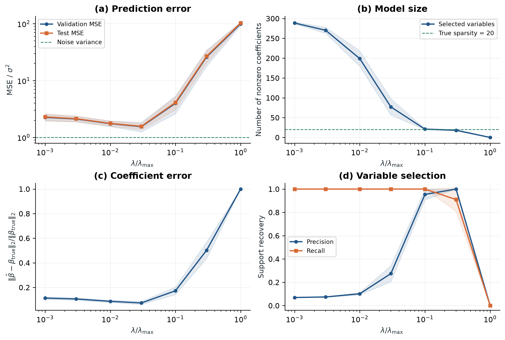

# 基于近端梯度法的 Lasso 稀疏回归求解与数值实验

使用随机生成的高维稀疏回归问题，独立实现近端梯度法 **ISTA** 和加速方法 **FISTA**，研究算法收敛、正则化强度、步长与数据条件的影响。所有结果均来自实际运行；scikit-learn 仅用于独立的高精度坐标下降核验。

**阅读报告：** [中文 PDF（11 页）](report/Lasso研究报告.pdf) · [可编辑 Word](report/Lasso研究报告.docx) · [LaTeX 源文件](report/lasso_report.tex)

## 问题与方法

求解目标为

$$
\min_{x\in\mathbb{R}^{p}}\;F(x)=\frac{1}{2n}\|Ax-b\|_2^2+\lambda\|x\|_1.
$$

ISTA 使用软阈值近端更新：

$$
x^{k+1}=\mathcal{S}_{\eta\lambda}\!\left(x^k-\frac{\eta}{n}A^\top(Ax^k-b)\right),\qquad
\eta=\frac{1}{L},\quad L=\frac{\|A\|_2^2}{n}.
$$

其中 $\mathcal{S}_{\tau}(z)_j=\operatorname{sign}(z_j)\max(|z_j|-\tau,0)$，矩阵 $2$ 范数为最大奇异值。两种算法均从零初始化，并要求**归一化 KKT 残差和原始—对偶间隙同时不超过 $10^{-6}$**。FISTA 使用标准动量形式，不使用重启。

训练集负责中心化和标准化，验证集负责选择 $\lambda$，独立测试集用于评价。报告分别讨论优化精度、参数恢复、变量筛选和预测效果。

## 实验规模

| 项目 | 设置 |
|---|---|
| 基础问题 | 300 个训练样本、1000 个特征、20 个真实非零系数 |
| 验证 / 测试样本 | 300 / 1000 |
| 随机重复 | 5 个固定种子 |
| 算法基准 | 特征相关系数 $\rho=0$、$0.8$；固定 $\lambda=0.05\lambda_{\max}$ |
| 步长比较 | ISTA 使用 $0.25/L$、$0.5/L$、$1/L$ |
| 正则化网格 | $\lambda/\lambda_{\max}\in\{0.001,0.003,0.01,0.03,0.1,0.3,1\}$ |
| 单因素实验 | 样本量、噪声比例、特征相关性；共享基础场景，共 7 个场景 |
| 候选模型拟合 | 35 个数据集 × 7 个候选参数 = 245 次 |
| 独立参照检查 | 10 个算法基准问题 + 35 个验证集选定问题 = 45 个 |

完整设置保存在 [experiment_config.json](experiment_config.json)。每个选定模型还使用 ISTA 重新求解，核对主体方法达到同一最优性要求。

## 主要结果

基础场景中，5 个种子均由验证集选出 $\lambda=0.03\lambda_{\max}$。

| 指标 | 均值 ± 样本标准差 |
|---|---:|
| 测试 MSE | 0.3480 ± 0.0575 |
| 参数相对误差 | 0.0738 ± 0.0124 |
| 估计非零系数个数 | 77.0 ± 20.7 |
| 支持集精确率 | 0.2745 ± 0.0693 |
| 支持集召回率 | 1.0000 ± 0.0000 |

预测较好并不意味着支持集精确恢复：该组模型找到了全部真实变量，同时仍包含假阳性变量。

| 特征相关系数 | ISTA 平均迭代次数 | FISTA 平均迭代次数 | ISTA 平均时间 / ms | FISTA 平均时间 / ms |
|---|---:|---:|---:|---:|
| 0 | 305.6 | 278.8 | 27.01 | 25.35 |
| 0.8 | 2053.8 | 1423.6 | 177.76 | 128.09 |

时间先对每个种子的 3 次计时取中位数，再跨种子平均。测试环境为 Apple M4、OpenBLAS 单线程；时间包含求解与证书检查，不含谱常数计算及数据生成。上述加速幅度只描述本次实验。





6 项数值测试已通过。已保存结果的核验记录见 [validation.json](results/validation.json)，文档检查见 [document_validation.json](results/document_validation.json)。所检查的 ISTA/FISTA 解与高精度参照解之间，目标函数绝对差最大约为 $3.90\times10^{-12}$。

## 快速复现

建议使用 Python 3.13；本次实际运行版本为 3.13.12。在仓库根目录运行：

```bash
python3.13 -m venv .venv
source .venv/bin/activate
python -m pip install -r requirements.txt

# 数学与实现正确性检查
python -m unittest discover -s tests -v

# 核验仓库中已有的实验结果
python verify_results.py

# 重新运行完整实验，并重新生成图表
python run_experiments.py
python verify_results.py
python make_figures.py
```

Windows 的虚拟环境激活命令为 `.venv\Scripts\activate`。完整实验本次约 73 秒，不含安装、绘图及文档编译；不同硬件和 BLAS 后端的时间会变化。

重新生成 PDF 和 Word：

```bash
python -m pip install -r requirements-report.txt
python build_report.py
```

PDF 编译需要含 CTeX 的 XeLaTeX 环境，例如 TeX Live 或 MacTeX。Word 导出使用 `pypandoc_binary` 自带的 Pandoc。可以直接下载现成报告，无需安装排版环境。

Apple Silicon 的计算后端选择、全部结果字段和更详细的操作说明见 [README.txt](README.txt)。本次正式实验使用 OpenBLAS，并在将 `RuntimeWarning` 视为异常的条件下运行。

## 文件导航

| 路径 | 内容 |
|---|---|
| [lasso.py](lasso.py) | 软阈值、ISTA/FISTA、谱常数及最优性证书 |
| [data.py](data.py) | 随机问题、训练集预处理和统计指标 |
| [run_experiments.py](run_experiments.py) | 全部实验与原始结果记录 |
| [verify_results.py](verify_results.py) | 结果完整性、停止条件、验证集选参及源文件哈希核验 |
| [make_figures.py](make_figures.py) | 图表与跨种子统计汇总 |
| [build_report.py](build_report.py) | 从实际结果生成报告表格、PDF 和 Word |
| [tests/](tests/) | 解析解、独立求解器、对偶证书和预处理等测试 |
| [results/](results/) | 原始 CSV、代表性迭代轨迹、基础问题 NPZ 和运行元数据 |
| [figures/](figures/) | 5 组 PNG 图片及 PDF 矢量图 |
| [report/](report/) | 报告、LaTeX 源文件和自动生成的数值表 |
| [MANIFEST.sha256](MANIFEST.sha256) | 本次提交文件的 SHA-256 校验清单 |

仓库保留数值数据与软件版本；公开元数据中的动态库路径仅保留文件名。核心实验源文件的哈希与本次运行一致。更新实验代码后，应重新运行实验再更新报告。仓库中的验证脚本会写回核验记录；原始求解结果不会因此重新计算。

## 参考文献

1. Tibshirani, R. (1996). *Regression Shrinkage and Selection via the Lasso*. [DOI](https://doi.org/10.1111/j.2517-6161.1996.tb02080.x)
2. Daubechies, I., Defrise, M., & De Mol, C. *An iterative thresholding algorithm for linear inverse problems with a sparsity constraint*. [arXiv:math/0307152](https://arxiv.org/abs/math/0307152)
3. Beck, A., & Teboulle, M. (2009). *A Fast Iterative Shrinkage-Thresholding Algorithm for Linear Inverse Problems*. [DOI](https://doi.org/10.1137/080716542)
4. [scikit-learn 1.6.1：Lasso 官方文档](https://scikit-learn.org/1.6/modules/generated/sklearn.linear_model.Lasso.html)
